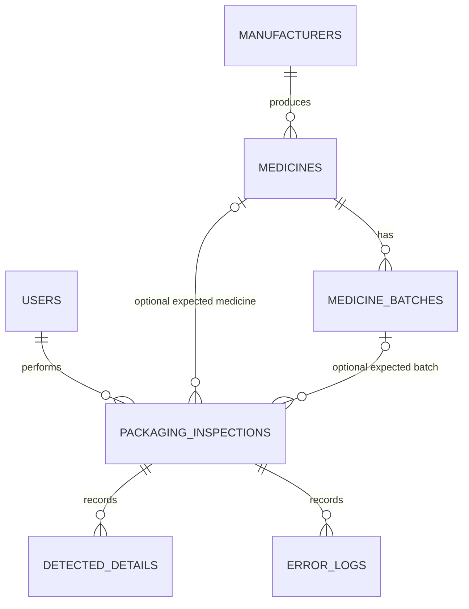

# Database design

The database is named `medicine_packaging_db`. Its setup script is
[`schema.sql`](./schema.sql) and targets MySQL 8.0.16 or newer.

## ER diagram



An inspection can have no selected medicine or batch when identification is
uncertain. When a batch is selected, the composite foreign key requires it to
belong to the selected medicine. The inspection-to-medicine and
inspection-to-batch foreign keys use `ON UPDATE RESTRICT` and `ON DELETE RESTRICT`:
catalog IDs are treated as immutable, and referenced catalog rows
cannot be removed while inspection history uses them. In particular, deletion
does not null out an inspection's historical medicine or batch references.
Using `ON UPDATE RESTRICT` on the inspection foreign keys also avoids the
MySQL restriction against a `CHECK`-referenced column participating in a
cascading foreign-key update.

## Tables

- **Users** stores unique login names/emails, password hashes, role, and account
  status. Inspection history references the user who performed the inspection.
- **Manufacturers** stores manufacturer identity and optional contact details.
- **Medicines** stores package configuration information and references one
  manufacturer. A non-NULL barcode is unique across registered configurations;
  multiple NULL barcodes are allowed.
- **Medicine_Batches** stores batch number and dates. A medicine can have many
  batches, and a batch number is unique within its medicine.
- **Packaging_Inspections** stores image path, user, selected expected medicine
  and optional batch, timestamp, and one of `MATCH`, `MISMATCH`, `EXPIRED`, or
  `NEEDS_REVIEW`.
- **Detected_Details** stores one row per OCR field per inspection, including
  extraction status and optional confidence. Missing/unreadable values are NULL,
  with the reason represented by `extraction_status`.
- **Error_Logs** stores validation findings and review findings. NULL
  `expected_value` means no registered expected value is available; NULL
  `detected_value` means OCR did not provide a usable value. The corresponding
  OCR status is recorded in `Detected_Details`.

## Setup script behavior

The synthetic seed inserts check for existing manufacturer, medicine, and
batch natural keys and skip records that already exist. They do not update
existing catalog values. A conflicting unique value such as a barcode assigned
to another medicine is left as an explicit insert error rather than silently
overwriting that record.

The script targets MySQL 8.0.16+ for enforced `CHECK` constraints. Local
`mysqld.exe` product metadata reported MySQL Server 26.10.0.1, but this schema
has not been executed against that server. Compatibility is a static
assessment, not a runtime test.

If a setup run stops partway through, refresh the Workbench schema navigator
before rerunning. Existing tables are not migrated by `IF NOT EXISTS`; the
corrected script can complete a fresh partial setup only when any already
created tables have the expected definitions. Do not drop the database merely
to restart setup.

## Workbench setup and verification

1. Connect to the intended local MySQL Server in Workbench.
2. Before rerunning after a failed attempt, inspect the objects in
   `medicine_packaging_db` using the inventory query below. Do not assume which
   statements ran. If an existing table has an older or unexpected definition,
   stop and review it before proceeding; `IF NOT EXISTS` will not repair it.
3. If the existing objects match this script's definitions, open
   `database/schema.sql` with **File → Open SQL Script…** and execute the full
   script. Keep `DELIMITER //` and `DELIMITER ;` intact so Workbench parses the
   trigger bodies correctly. Review Action Output for errors.
4. Run the read-only verification queries below and check the returned object
   names and synthetic seed rows. DDL statements can commit individually, so
   an execution error may leave a partial setup.

Inventory tables, views, and triggers:

```sql
SELECT 'TABLE' AS object_type, TABLE_NAME AS object_name
FROM INFORMATION_SCHEMA.TABLES
WHERE TABLE_SCHEMA = 'medicine_packaging_db'
  AND TABLE_TYPE = 'BASE TABLE'
UNION ALL
SELECT 'VIEW', TABLE_NAME
FROM INFORMATION_SCHEMA.VIEWS
WHERE TABLE_SCHEMA = 'medicine_packaging_db'
UNION ALL
SELECT 'TRIGGER', TRIGGER_NAME
FROM INFORMATION_SCHEMA.TRIGGERS
WHERE TRIGGER_SCHEMA = 'medicine_packaging_db'
ORDER BY object_type, object_name;
```

Verify table engines and the server version:

```sql
SELECT VERSION() AS server_version, @@version_comment AS server_product;

SELECT TABLE_NAME, ENGINE
FROM INFORMATION_SCHEMA.TABLES
WHERE TABLE_SCHEMA = 'medicine_packaging_db'
  AND TABLE_TYPE = 'BASE TABLE'
ORDER BY TABLE_NAME;
```

Verify foreign keys, including the inspection medicine/batch references:

```sql
SELECT TABLE_NAME, CONSTRAINT_NAME, COLUMN_NAME,
       REFERENCED_TABLE_NAME, REFERENCED_COLUMN_NAME
FROM INFORMATION_SCHEMA.KEY_COLUMN_USAGE
WHERE TABLE_SCHEMA = 'medicine_packaging_db'
  AND REFERENCED_TABLE_NAME IS NOT NULL
ORDER BY TABLE_NAME, CONSTRAINT_NAME, ORDINAL_POSITION;
```

Verify view and trigger names:

```sql
SELECT TABLE_NAME AS view_name
FROM INFORMATION_SCHEMA.VIEWS
WHERE TABLE_SCHEMA = 'medicine_packaging_db'
ORDER BY TABLE_NAME;

SELECT TRIGGER_NAME, EVENT_MANIPULATION, ACTION_TIMING
FROM INFORMATION_SCHEMA.TRIGGERS
WHERE TRIGGER_SCHEMA = 'medicine_packaging_db'
ORDER BY TRIGGER_NAME;
```

Verify synthetic reference records:

```sql
SELECT mf.manufacturer_name, m.medicine_name, m.strength, m.dosage_form,
       b.batch_number, b.manufactured_on, b.expiry_date
FROM Manufacturers AS mf
LEFT JOIN Medicines AS m ON m.manufacturer_id = mf.manufacturer_id
LEFT JOIN Medicine_Batches AS b ON b.medicine_id = m.medicine_id
WHERE mf.manufacturer_name IN (
    'Example Pharma Labs (SYNTHETIC)',
    'Demo Health Products (SYNTHETIC)'
)
ORDER BY mf.manufacturer_name, m.medicine_name, b.batch_number;
```

## Status and audit behavior

The application starts an inspection in `NEEDS_REVIEW`. The error-log insert
trigger applies this precedence:

1. `EXPIRED` for an `expired_batch` finding.
2. `MISMATCH` when a finding has both expected and detected values.
3. `NEEDS_REVIEW` when either value is unknown or unavailable.

An existing `EXPIRED` or `MISMATCH` status is not downgraded by a later review
finding. The application may set `MATCH` only after all required comparisons
pass with sufficient OCR confidence. The trigger trusts that non-NULL
expected/detected pairs inserted into `Error_Logs` are actual findings; it does
not perform text normalization or independently compare values.

There is no application/backend code in this workspace to verify that this
`MATCH` rule is implemented by the inspection workflow. The schema itself does
not prevent a privileged caller from directly setting `MATCH`; that rule must
be enforced by the application before inspections are used operationally.

`Error_Logs` is append-only: update/delete triggers reject changes, and its
foreign key restricts deleting an inspection that has logged findings. A
correction should be recorded as a new inspection. A database account with
privileges to drop triggers or alter the schema could bypass this protection;
the application account should therefore use least-privilege grants.

The inspection summary view reports both `error_count` (findings with both
values known) and `review_finding_count` (findings with at least one unknown
value), so missing OCR does not inflate the mismatch count.

## Normalization

- **1NF:** Fields contain single values. OCR observations are rows in
  `Detected_Details`, rather than repeating groups on the inspection row.
- **2NF:** Each table's non-key values describe its full key. In particular, an
  OCR value belongs to the combination of inspection and field; the unique key
  enforces one selected reading per field and inspection.
- **3NF:** Manufacturer attributes are stored once in `Manufacturers`; medicine
  attributes reference the manufacturer; batch dates are stored in
  `Medicine_Batches`; inspection and OCR data are separate from catalog data.

`Packaging_Inspections.medicine_id` is retained alongside `batch_id` so an
inspection can record an expected medicine even when its batch is unknown. The
composite foreign key prevents the two references from disagreeing when both
are present. Error-log values intentionally snapshot the values involved in a
finding so later catalog changes do not rewrite inspection history.
